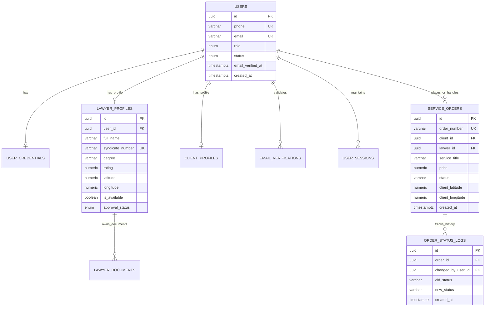

# 🗄️ توثيق قاعدة بيانات MyLawyer الإنتاجية (PostgreSQL Schema & Models)

> **محرك قاعدة البيانات:** PostgreSQL 16.x مع ملحقات `uuid-ossp` و `pgcrypto`  
> **السيرفر المستضيف:** Contabo Cloud (Germany) - IP: `13.140.141.32`

---

## 📌 1. مخطط الكيانات والعلاقات (ER Diagram)

---

## 🚀 2. استراتيجية الفهارس والأداء (Performance Indices)

1. **فهارس البحث الجغرافي السريع (Geo Query Indices):**
   - `idx_lawyer_profiles_availability` على الأعمدة `(approval_status, is_available, last_active_at)`.
   - `idx_lawyer_profiles_coords` على الأعمدة `(latitude, longitude)`.
   - الفهارس دي بتخدم توزيع الطلب على أقرب المحامين ومربعات الخريطة.

2. **فهارس الطلبات ومتابعة الحالات:**
   - `idx_orders_client_id`: استرجاع طلبات العميل مرتبة زمنياً.
   - `idx_orders_lawyer_id`: استرجاع مهام المحامي الجارية.
   - `idx_orders_status`: فرز الطلبات حسب الحالة (PENDING / IN_PROGRESS).
   - `idx_order_logs_order`: تتبع كامل لسجل الحالات وتاريخ التحويلات.

3. **سلامة العمليات المتزامنة (Concurrency & Idempotency):**
   - استخدام الـ Database Transactions `withTransaction` عند إنشاء أو قبول الطلبات يمنع قبول الطلب من أكثر من محامٍ في نفس الوقت (`Race Conditions`).
   - مفتاح فريد `order_number` لمنع تكرار الفواتير والطلبات.

---

## 🧾 4. الجداول الحالية حسب التحديثات (Migrations)

التحديثات في `backend/migrations` بتتطبق لوحدها مع كل تشغيل للسيرفر، بالترتيب، ومرة واحدة لكل تحديث. لو تحديث فشل السيرفر مش بيشتغل. `022` فهارس بس، ومفيهوش تغيير بيانات.

| التحديث | الجداول والأعمدة |
|---|---|
| `001` | `users`، `user_credentials`، `user_sessions`، `email_verifications`، `password_resets`، `lawyer_profiles`، `lawyer_documents` |
| `002` | `service_orders`، `order_status_logs`، وموقع المحامي وإتاحته |
| `003` | `complaints`، `order_appeals`، `client_credits`، `reviews`، `problem_prices`، `client_problem_prices`، `notifications`، `lawyer_strikes`، `lawyer_reports` |
| `004` | `device_tokens` لإشعارات الموبايل |
| `005`–`007` | حداثة موقع المحامي، وسبب قفل الإتاحة |
| `008` | نسبة الضريبة في الطلب وشروط الخدمة |
| `009` | حالة التقديم على «محاميك حالاً» `urgent_status` |
| `016` | تصحيح نصوص الإشعارات القديمة اللي كانت بتتكلم عن الكود |
| `015` | `notifications.ticket_id` عشان الإشعار يفتح تذكرته، والاعتراضات المفتوحة اتنقلت لتذاكر |
| `014` | `support_tickets` و`ticket_messages` و`ticket_attachments` للدعم الفني، والشكاوى المفتوحة القديمة اتنقلت لتذاكر |
| `013` | `service_orders.review_reminder_sent` لتذكير التقييم مرة واحدة |
| `012` | ترقيم ML الموحد: `order_number` و`reference` في `complaints` و`lawyer_reports` و`order_appeals` و`wallet_transfers`، كل واحد بتسلسل خاص بيه |
| `011` | `wallet_transfers`: كل تحويل بين حسابين، والفلوس نفسها بتتسجل في `client_credits` أو `lawyer_adjustments` |
| `010` | `account_warnings`، و`lawyer_adjustments`، و`users.suspended_until`، ونوع الشكوى `kind` في `complaints` و`lawyer_reports` |

**الفلوس:**
- **رصيد الموكل:** مجموع `client_credits`، وفيه الردود والتسويات وحركات الإدارة والدفع من الرصيد بالسالب.
- **أتعاب المحامي:** `payout_amount` في الطلب حسب `payout_status`: `HELD` أو `FROZEN` أو `AVAILABLE` أو `REFUNDED`.
- **حركات الإدارة على المحامي:** في `lawyer_adjustments`، وبتتجمع على المتاح.
- **الرصيد السالب:** دين بيتسدد من المبالغ اللي بتدخل بعده.

**الإنذارات:** في `account_warnings` للطرفين. الإنذار الملغى `revoked_at` ما بيتحسبش، و3 سارية في 30 يوم بتوقف الحساب أسبوع عبر `users.suspended_until`.

## 5. جداول الأموال والمتابعة
| الجدول | الغرض |
|---|---|
| `payments` | كل دفعة موكل برقم `ML-PAY` وطريقتها: `WALLET` من الرصيد، أو `DIRECT` من غير بوابة دفع (migration `018`). |
| `failed_payments` | محاولة دفع ما تمتش وسببها، عشان تظهر للموكل في صفحة المدفوعات (migration `029`). |
| `payout_events` | سجل تجميد الأتعاب وفكها وتسويتها، ومن قام بذلك (migration `017`). |
| `admin_actions` | قرارات الإدارة: الحسابات والأسعار والنسب وطلبات المحامين والتعليقات وإعدادات الاستشارة (migration `019`). |
| `consultation_settings` | صف واحد: سعر الاستشارة، وسعر الاطلاع الأساسي، وسعر الورقة، وأقصى عدد ورق، ومدة المكالمة، وأقل طول للتفاصيل، والإتاحة (migration `032`). |
| `consultations` | كل استشارة سريعة برقم `ML-CNS` ونوعها وتفاصيلها وسعرها وطريقة دفعها وحالتها (`PAID` ثم `CONTACTING` ثم `DONE`، أو `REJECTED` والمبلغ بيرجع للرصيد في `client_credits`) (migration `032`). |
| `consultation_pages` | صور الورق في التخزين الخاص `consultations/`، لصاحب الاستشارة والإدارة بس (migration `032`). |
| `order_status_logs` | كل مراحل الطلب، و`changed_by_user_id` فاضي لما النظام هو اللي نفذ (migration `019`). |

عمودا `specialty` و`bio` في `lawyer_profiles` مش مستخدمين في النظام، و`experience_years` بيتكتب عند تسجيل المحامي وقيمته الافتراضية 0 (migration `020`).

جداول `complaints` و`lawyer_reports` و`order_appeals` و`lawyer_approval_history` اتشالت في migration `021` بعد ما حلت محلها تذاكر الدعم.

## 6. جداول ما كانتش متوثقة (اتراجعت على الـ migrations 2026-11-07)
| الجدول | migration | لازمته |
|---|---|---|
| `service_requests` | `024` | طلب «محاميك حالاً» قبل ما يبقى طلب: مكان الموكل، والمشكلة، وحدود السعر، والعمولة والضريبة وقتها، ورقم الجولة وموعد نهايتها، والحالة (`OPEN` و`SELECTED` و`NO_OFFERS` و`EXPIRED` و`CANCELLED`)، والطلب اللي اتعمل منه |
| `request_recipients` | `024` | مين وصله الطلب في أنهي جولة وعلى بعد كام كيلو. مفتاحه الطلب + المحامي |
| `request_offers` | `024` | عرض المحامي: السعر وصافيه، ولو سحبه. عرض واحد لكل محامي في الطلب |
| `change_log` | `028` | سجل التغييرات للخط المباشر (`/events`): مين، ونوع، وأنهي حاجة. بيتمسح بعد يومين |
| `platform_settings` | `008` | صف واحد بس لإعدادات المنصة، زي نسبة الضريبة |
| `password_reset_requests` | `001` | أكواد تغيير كلمة السر (متخزنة hash)، ومحاولاتها، ومتى اتستخدمت |
| `admin_login_codes` | `040` | الخطوة التانية لدخول لوحة التحكم: كود الإيميل (hash بس)، 10 دقايق و5 محاولات ومرة واحدة (`auth/adminCode.ts`) |

## 7. آخر الـ migrations
| الرقم | التغيير |
|---|---|
| `032` | الاستشارة السريعة: الإعدادات، والاستشارات، وصور الورق في التخزين الخاص |
| `033` | الاستشارة: «مقدرناش نوصلك» (`unreachable_at`) و«طلب التواصل» (`callback_requested_at`) |
| `034` | `notifications.consultation_id`: الإشعار بيفتح الاستشارة |
| `035` | `lawyer_profiles.governorate` و`governorate_at`، وفهارس خريطة المحامين وقايمة المحافظة |
| `036` | شيل جداول «أماكن التواجد» (`presence_*`) اللي اتعملت في `031` |
| `037` إلى `039` | إيقاظ المحامي الساكت، وشيل مسار قديم، وسبب قفل الطلب قبل الدفع (`release_reason`) |
| `040` | `admin_login_codes` للدخول بخطوتين في اللوحة |

المرجع دايمًا `backend/migrations`. الـ migrations بتشتغل لوحدها مع تشغيل الخادم، وكل رقم بيشتغل مرة واحدة.
