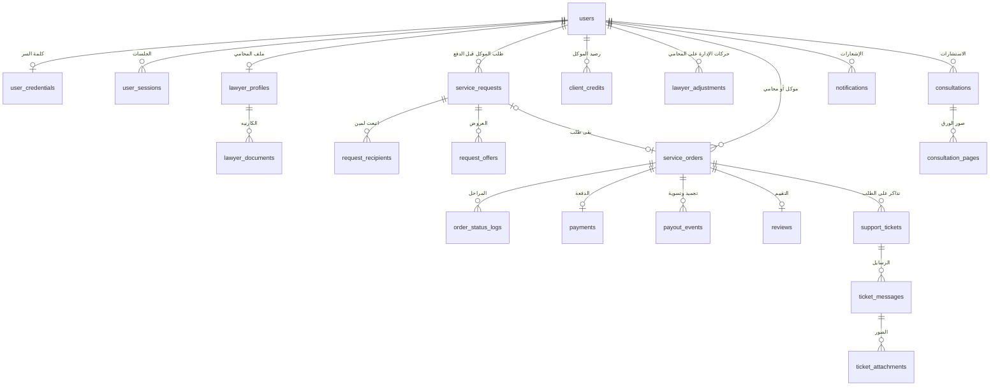

# قاعدة البيانات

**آخر تحقق:** 2026-11-11، بالقراية من القاعدة الشغالة نفسها (`mylawyer_prod`) ومقارنتها بـ `backend/migrations`. **المرجع دايمًا `backend/migrations`**: الملف ده وصف للوضع الحالي، مش تاريخ.

## 1. الأساسيات
| البند | القيمة |
|---|---|
| النوع | PostgreSQL 16.15 على السيرفر الأساسي (`mylawyer-api`)، بملحقين: `pgcrypto` و`uuid-ossp` |
| القاعدة | `mylawyer_prod`، حجمها 13 ميجا (2026-11-11) |
| نسخة القراية | نسخة حية على السيرفر التاني، بتتحدّث لحظة بلحظة، للخريطة والقوايم والتقييمات (`readQuery` في `src/database/index.ts`) |
| الحسابات | `mylawyer_user` (الخادم، من غير صلاحيات إدارة)، و`replicator` (النسخة الحية بس)، و`postgres` (محلي على السيرفر بس) |
| الاتصال | محلي، ومن السيرفر التاني على الخط الخاص بس (`pg_hba.conf`). مقفول على الإنترنت |
| التحديثات | 47 ملف في `backend/migrations` (من `001` لـ `046`)، كلهم متطبقين على الإنتاج. بيشتغلوا لوحدهم مع تشغيل الخادم بالترتيب ومرة واحدة (`src/database/migrate.ts`، جدول `schema_migrations`)، ولو واحد فشل الخادم ما بيشتغلش |
| الأرقام | 36 جدول، و114 فهرس، و58 علاقة، و21 شرط `CHECK`، وtrigger واحد (`updated_at` في `service_orders`). مفيش views ولا stored procedures |

## 2. الصورة العامة

## 3. الجداول
«بيستخدمه» هو المكان في `backend/src/modules` اللي بيكتب فيه.

### الحسابات والدخول
| الجدول | فيه إيه | بيستخدمه |
|---|---|---|
| `users` | الحساب: الموبايل والإيميل (فريدين)، والدور (`client`، `lawyer`، `admin`)، والحالة، والاسم، والصورة، و`suspended_until`، و`warnings_count`، و`deletion_requested_at` و`deleted_at` (حذف الحساب)، و`is_review_account` (حسابات مراجعة جوجل، migration `046`) | `auth`، `users`، `admin` |
| `user_credentials` | كلمة السر (argon2id)، واحدة لكل حساب | `auth` |
| `user_sessions` | الجلسات: hash للـ refresh token، والجهاز، والعنوان، والانتهاء والإلغاء | `auth/session.ts` |
| `email_verifications` | كود تأكيد الإيميل (hash)، ومحاولاته | `auth/register.ts` |
| `password_reset_requests` | كود تغيير كلمة السر (hash)، ومحاولاته | `auth/password.ts` |
| `admin_login_codes` | الخطوة التانية لدخول اللوحة: كود الإيميل (hash)، 10 دقايق و5 محاولات ومرة واحدة | `auth/adminCode.ts` |
| `device_tokens` | موبايلات كل حساب لإشعارات Firebase | `notifications`، `services/pushService.ts` |

### المحامي
| الجدول | فيه إيه | بيستخدمه |
|---|---|---|
| `lawyer_profiles` | الملف المهني، وحالة الاعتماد، والمكان و«متاح»، والتقييم وعدده، وحالة «محاميك حالاً» (`urgent_status`)، والمحافظة، وعدّاد الإيقاظ | `lawyers`، `lifecycle/sweep.ts` |
| `lawyer_documents` | ملفات الكارنيه في المخزن الخاص | `lawyers` |
| `lawyer_strikes` | مخالفات المحامي (اعتذار، عدم رد...)، والملغي منها | `lifecycle/service.ts`، `admin/accounts.ts` |
| `lawyer_adjustments` | حركات الإدارة والتحويلات على أتعاب المحامي | `admin`، `wallet`، `support/admin.ts` |

### «محاميك حالاً»
| الجدول | فيه إيه | بيستخدمه |
|---|---|---|
| `service_requests` | الطلب قبل الدفع: مكان الموكل، والمشكلة، وحدود السعر، والعمولة والضريبة وقتها، والجولة، والحالة (`OPEN`، `SELECTED`، `NO_OFFERS`، `EXPIRED`، `CANCELLED`) | `requests` |
| `request_recipients` | مين وصله الطلب، في أنهي جولة، وعلى بعد كام كيلو، ووقت الطريق (`road_seconds`) | `requests/service.ts` |
| `request_offers` | عرض المحامي: السعر وصافيه، ولو سحبه. عرض واحد لكل محامي في الطلب | `requests` |
| `service_orders` | الطلب بعد اختيار العرض: الأطراف، والسعر والعمولة والضريبة، والحالة، والمهل، والوصول، والتأجيل، والأتعاب (`payout_status`، `payout_amount`)، والمكان اللحظي للطرفين | `orders`، `lifecycle` |
| `order_status_logs` | كل مراحل الطلب. `changed_by_user_id` فاضي لما النظام هو اللي نفّذ | `orders`، `lifecycle` |
| `problem_prices` | حدود السعر ونسبة المنصة لكل مشكلة | `admin/routes.ts`، `requests` |
| `field_requests` | تفاصيل الطلب الميداني (migration `047`)، صف لكل `service_requests`: لنفسه أو لشخص تاني، واسم الشخص وصلته ومحبوس ولا لأ، واسم المكان ونوعه ونطاق الوصول بالمتر، وكود التسليم (4 أرقام، لشخص تاني بس) ومحاولاته الغلط، وطريقة إثبات الوصول (`area` و`code` و`client`)، ووقت رفض الشخص | `field`، `orders/queries.ts` |
| `field_proofs` | صور الإثبات اللي المحامي رفعها للإدارة (اسم الملف في `PRIVATE_STORAGE_PATH/field-proofs`). لحد 5 للطلب | `field/routes.ts` |
| `reviews` | تقييم الموكل للمحامي (واحد لكل طلب)، والإخفاء والبلاغ | `orders/reviews.ts`، `admin` |

### الفلوس
| الجدول | فيه إيه | بيستخدمه |
|---|---|---|
| `payments` | كل دفعة موكل برقم `ML-PAY` وطريقتها: `WALLET` أو `DIRECT` (من غير بوابة دفع حقيقية) | `orders/decisions.ts`، `consultations` |
| `failed_payments` | محاولة دفع ما تمتش وسببها، لصفحة المدفوعات | `orders/decisions.ts` |
| `client_credits` | دفتر رصيد الموكل: الردود، والتسويات، وحركات الإدارة، والدفع من الرصيد بالسالب. **الرصيد = مجموع الجدول** | `lifecycle`، `wallet`، `admin` |
| `payout_events` | سجل تجميد الأتعاب وفكها وتسويتها، ومين عمل كده | `lifecycle/settlement.ts`، `admin/orders.ts` |
| `wallet_transfers` | كل تحويل بين حسابين برقم `ML-TRF`. الفلوس نفسها في `client_credits` أو `lawyer_adjustments` | `wallet` |
| `platform_settings` | صف واحد: نسبة الضريبة، وأقل نسخة مسموحة من التطبيق ورابط التحديث | `admin/routes.ts`، `appClient` |

**قواعد الفلوس:** أتعاب المحامي في `service_orders.payout_amount` حسب `payout_status` (`HELD` ثم `AVAILABLE`، أو `FROZEN`، أو `REFUNDED`). الرصيد السالب دين بيتسدد من اللي بيدخل بعده. منطق الفلوس ما يتغيرش غير بطلب صريح من صاحب المشروع.

### الدعم، والاستشارة، والإشعارات، والإدارة
| الجدول | فيه إيه | بيستخدمه |
|---|---|---|
| `support_tickets` | التذكرة برقم `ML-TKT`، ونوعها، وحالتها (`UNDER_REVIEW`، `OPEN`، `CLOSED`)، والطلب لو عليه | `support` |
| `ticket_messages` | الرسايل: `USER` أو `ADMIN` أو `NOTE` (ملاحظة داخلية) | `support` |
| `ticket_attachments` | صور الرسايل في المخزن الخاص | `support` |
| `consultations` | الاستشارة برقم `ML-CNS`: النوع (`CALL`، `PAPERS`)، والسعر، والدفع، والحالة (`PAID`، `CONTACTING`، `DONE`، `REJECTED`)، و`input_method` (`TEXT` أو `VOICE`، migration `048`: النص اللي اتحول من الكلام للإدارة بس)، و`service_title` (migration `049`: الخدمة اللي الموكل اختارها من الرئيسية: «استشارة قانونية» أو «اطلاع على مستندات» أو «كتابة عقد أو مستندات»، والقديمة `NULL`) | `consultations` |
| `consultation_pages` | صور الورق في المخزن الخاص | `consultations` |
| `consultation_settings` | صف واحد: الأسعار، وأقصى ورق، ومدة المكالمة، والإتاحة | `consultations/admin.ts` |
| `notifications` | الإشعار، ومربوط بطلب أو تذكرة أو طلب قبل الدفع أو استشارة | `lifecycle/service.ts` (`notify`) |
| `change_log` | سجل التغييرات للخط المباشر (`/events`). بيتمسح بعد يومين | `services/liveUpdates.ts` |
| `account_warnings` | إنذارات الطرفين. 3 سارية في 30 يوم بتوقف الحساب أسبوع | `admin/accounts.ts` |
| `admin_actions` | سجل قرارات الإدارة | `admin/actions.ts` |
| `app_errors` | أعطال التطبيق على الموبايلات. بيتمسح بعد 30 يوم | `appClient` |
| `schema_migrations` | التحديثات اللي اتطبقت | `database/migrate.ts` |

## 4. قواعد الحذف
- **ما بيتمسحش وله سجلات** (`RESTRICT`): الحساب اللي عليه طلبات أو دفعات أو رصيد أو تقييمات أو تحويلات أو تذاكر أو استشارات. يعني السجلات المالية ما بتضيعش بمسح حساب.
- **بيتمسح مع صاحبه** (`CASCADE`): الجلسات، والأكواد، وموبايلات الإشعارات، وملف المحامي ومستنداته، والإشعارات، والطلبات قبل الدفع وعروضها.
- **بيفضل والربط يتفك** (`SET NULL`): اسم الموظف اللي عمل الإجراء، والطلب المربوط بتذكرة أو إنذار.

## 4.1 حذف الحساب (migration `045`، `users/deletion.ts`)
- الطلب بيسجّل `deletion_requested_at`، وبيلغي الجلسات، ويشيل موبايلات الإشعارات، ويقفل «متاح». الدخول قبل 30 يوم بيلغيه.
- بعد 30 يوم (المسح كل ساعة): كلمة السر، والجلسات، والأكواد، والإشعارات، ومستندات المحامي، وصور الورق والتذاكر بتتمسح من القاعدة ومن الديسك. الاسم بيبقى «حساب محذوف»، والموبايل والإيميل بقيم وهمية فريدة، والحالة `suspended`، و`deleted_at` بيتسجل.
- الطلبات والدفعات والتحويلات والتقييمات بتفضل للحسابات، مربوطة بالحساب المجهول.
- لو فلوس دخلت الحساب بعد الطلب، المسح بيستنى لحد ما الرصيد يبقى صفر.

## 5. الفهارس المهمة
| الفهرس | لازمته |
|---|---|
| `idx_lawyer_profiles_near` (GiST) | أقرب المحامين المتاحين للموكل، مترتبين بالمسافة (migration `043`) |
| `idx_lawyer_profiles_showcase` و`idx_lawyer_profiles_governorate` و`idx_lawyer_profiles_available` | مربعات الخريطة، وقايمة أعلى المحافظة، والمتاحين للمهام الزمنية (migrations `035` و`043`) |
| `idx_orders_client_id` و`idx_orders_lawyer_id` و`idx_orders_status` | طلبات كل طرف، والمهام الزمنية |
| `idx_order_logs_order` | مراحل الطلب |

**التزامن:** الدفع والإلغاء والاعتذار والإنهاء والوصول بيبدأوا بقفل الطلب (`lockOrder`) جوه معاملة واحدة، والدفع من الرصيد بياخد نفس قفل الحساب بتاع التحويل. اختبار «العاصفة» (`tests/storm.test.ts`) بيتأكد إن مفيش محامي اتحجز مرتين ولا جنيه ضاع.

## 6. موجود في القاعدة ومش مستخدم (ما اتمسحش)
اتأكدت يوم 2026-11-11 إن الكود ما بيلمسهمش. المسح محتاج migration وموافقة صاحب المشروع، ومسجّل في `KNOWN_ISSUES.md`.
| العنصر | الوضع |
|---|---|
| أعمدة `service_orders`: `code_attempts`، `reminder_first_sent`، `reminder_second_sent` | من نظام كود الإنهاء والتذكيرين القديم |
| أعمدة `lawyer_profiles`: `specialty`، `bio`، `current_status` | ما بتتقراش ولا بتتكتب |
| تسلسلات `ml_complaint_seq`، `ml_report_seq`، `ml_appeal_seq` | جداولها اتشالت في migration `021` |
| 20 عمود علاقة من غير فهرس (زي `created_by` و`revoked_by`) | مش مشكلة بالحجم الحالي. يتراجع لو مسح الحسابات بقى بطيء |
