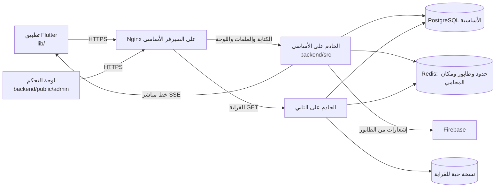

# خريطة المشروع

خريطة سريعة لأي حد جديد: كل حاجة فين، والطلب بيمشي إزاي من الموبايل للسيرفر وراجع. التفاصيل في الملفات اللي جنب كل سطر.

## 1. الصورة كلها

السيرفرين: `SERVER_ARCHITECTURE.md`. الرفع: `DEPLOYMENT.md`. لو الأساسي وقع: `BACKUP_AND_RECOVERY.md`.

## 2. التطبيق `lib/`
| المكان | فيه إيه |
|---|---|
| `main.dart` | البداية، وقراية المحفوظ (`SavedData.preload`) قبل أول شاشة |
| `core/config/` | عنوان الخادم لكل بيئة |
| `core/constants/` | الألوان والخطوط وإعدادات الخريطة، وقواعد عرض التقييم (`rating_rules.dart`) |
| `core/theme/` | الحواف والثيم (`AppTheme`) |
| `core/services/` | الخدمات: الشبكة (`api_service`)، والدخول (`auth_service`)، والخط المباشر (`live_updates`)، ومخزن الطلبات (`order_store`)، والإشعارات (`notification_center`، `push_service`)، والموقع (`location_service`، `background_location_service`)، والمحفوظ (`saved_data`) |
| `core/widgets/` | كل المكونات المشتركة. قبل ما تعمل جديد شوف `WORK_RULES.md` القسم 1 |
| `data/models/` | شكل البيانات (طلب، عرض، محامي، إشعار...) |
| `data/repositories/` | **كل طلبات الشبكة من هنا بس**، وكل واحد بيحفظ آخر نسخة عشان الشاشة تظهر فورًا |
| `features/auth/` | الدخول والتسجيل والأذونات، و`session_router` بيقرر أول شاشة |
| `features/client/` | شاشات الموكل: الرئيسية والطلبات والمحفظة والحساب والخريطة الترويجية |
| `features/lawyer/` | شاشات المحامي، وشيت إرسال السعر |
| `features/urgent_service/` | «محاميك حالاً»: الخريطة والعروض والدفع وتفاصيل الطلب (`order_details_sheet`) |
| `features/consultation/` | «استشارة سريعة» |
| `features/notifications/` | صفحة الإشعارات، و`notification_router` بيفتح الصفحة اللي الإشعار بيتكلم عنها |
| `features/support/` | الدعم الفني والتذاكر |
| `features/account/` | البيانات الشخصية والمدفوعات |
| `test/` | اختبارات التطبيق (`flutter test`) بخادم وهمي |

## 3. الخادم `backend/`
| المكان | فيه إيه |
|---|---|
| `src/server.ts` | العملية الرئيسية والـ workers، والمهام الزمنية، والطابور، والإيقاف الهادي |
| `src/app.ts` | Fastify: الحماية، وحدود الطلبات، وفحص الحالة، وتسجيل كل المسارات |
| `src/config/` | الإعدادات من `.env` |
| `src/database/` | الاتصال (`dbPool`، و`readQuery` للنسخة الحية)، والمعاملات، والـ migrations |
| `src/services/` | Redis (`fastMemory`)، والطابور (`jobQueue`)، والإشعارات (`pushService`)، والإيميل، والخط المباشر (`liveUpdates`)، ووقت الطريق (`roadRoutes`) |
| `src/modules/auth/` | التسجيل والدخول (وخطوتين للإدارة) وكلمة السر ومحاولات الدخول |
| `src/modules/requests/` | «محاميك حالاً» قبل الدفع: الطلب، واختيار أقرب المحامين، والعروض، والاختيار |
| `src/modules/orders/` | بعد الاختيار: الدفع، والوصول، والتأجيل، والإنهاء، والتقييم، وقراية الطلبات |
| `src/modules/lifecycle/` | القواعد المشتركة (`notify`، والمخالفات، والتسوية)، والمهام الزمنية (`sweep.ts`) |
| `src/modules/lawyers/` | ملف المحامي ومكانه، والخريطة والقوايم للعرض (`showcase.ts`) |
| `src/modules/notifications/` | الإشعارات والعدادات، وقاعدة «اتصرفت = اتقرا» (`readOnAction.ts`) |
| `src/modules/consultations/`، `support/`، `wallet/`، `users/`، `routes/` | الاستشارة، والدعم، والمحفظة، والحساب، ووقت الطريق |
| `src/modules/admin/` | مسارات لوحة التحكم، كلها للإدارة بس |
| `public/admin/` | لوحة التحكم (JavaScript من غير مكتبات) |
| `public/site/` | الموقع العام والسياسات |
| `migrations/` | كل تغيير في القاعدة بملف مرقّم، وبيشتغل لوحده مع التشغيل |
| `tests/` | اختبارات الخادم على قاعدة جوه الذاكرة (`npm test`) |
| `ops/` | سكريبتات السيرفرات: النسخ، والمراقبة، والرفع للتاني، والتحويل |
| `scripts/loadtest/` | اختبار الضغط (`LOAD_TEST.md`) |
| `deploy.sh` | الرفع على السيرفر (بيشتغل لوحده مع أي push) |

## 4. رحلة «محاميك حالاً» في الكود
| الخطوة | التطبيق | الخادم |
|---|---|---|
| الموكل يطلب | `urgent_service/tracking_screen_order_flow.dart` ← `RequestRepository.send` | `POST /requests` ← `requests/service.ts` يختار أقرب المحامين بالطريق ويبعتلهم |
| المحامي يبعت سعر | `lawyer/request_offer_sheet.dart` | `POST /requests/:id/offer` |
| العروض توصل الموكل | الخط المباشر يحدّث الشاشة | `notify` ← `publishChange` ← SSE |
| الموكل يختار ويدفع | `payment_screen.dart` | `/requests/:id/offers/:offerId/select` ثم `/orders/:id/confirm-payment` |
| المحامي في الطريق | `background_location_service.dart` بيبعت مكانه | `/orders/:id/position` ← Redis ← الموكل |
| وصل، أجّل، أنهى | `order_details_sheet.dart` | `orders/progress.ts` |
| التقييم | شيت التقييم في تفاصيل الطلب | `orders/reviews.ts` ← `refreshLawyerRating` |
| المهل (دفع، وصول، تأخير) | — | `lifecycle/sweep.ts` كل كام ثانية |

## 5. لو عايز تغيّر...
| الحاجة | روح لـ |
|---|---|
| لون أو حافة | `core/constants/app_colors.dart` و`core/theme/app_theme.dart` |
| نص إشعار أو هل بيرن | `notify(...)` في الخادم، و`QUIET_TITLES` في `lifecycle/service.ts` |
| مهلة (دفع، وصول، تأجيل) | الثوابت في أول `lifecycle/service.ts` و`orders/progress.ts` |
| قواعد التقييم | `core/constants/rating_rules.dart` والـ `TRUSTED_RATING` في `lawyers/showcase.ts` |
| مسار جديد | ملف الـ module، وسطر في `API_DOCUMENTATION.md`، واختبار في `backend/tests` يتضاف لـ `package.json` |
| جدول أو عمود | ملف جديد في `backend/migrations` بالرقم اللي بعده، و`DATABASE_ARCHITECTURE.md` |
