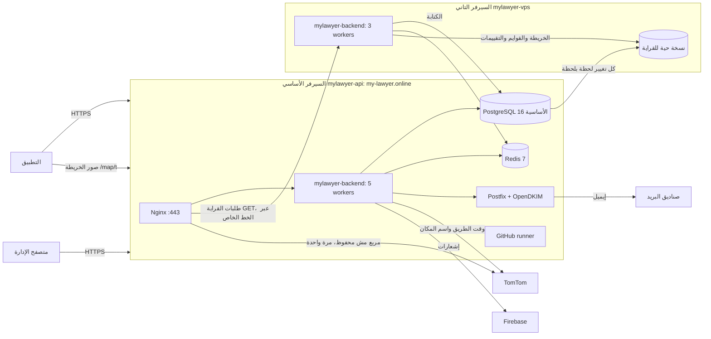

# بنية السيرفرات

**آخر تحقق:** 2026-11-10 (قراءة من السيرفرين). بيانات الدخول وطريقته في `docs/ACCESS.md`، وممنوع أي سر هنا.

## 1. الصورة العامة


## 2. السيرفر الأساسي `mylawyer-api`
| البند | القيمة |
|---|---|
| الموارد | Contabo Cloud VPS 6: 6 معالجات، و12 جيجا رام، و100 جيجا، وSwap 4 جيجا |
| النظام | Ubuntu 24.04، والتوقيت Europe/Berlin |
| الخدمات | `mylawyer-backend` (systemd، `127.0.0.1:4000`، `WEB_WORKERS=5`، حد ذاكرة 8 جيجا)، وPostgreSQL 16 محلي بس، وNginx 1.24، وPostfix (محلي بس، IPv4) وOpenDKIM، وfail2ban، والـ runner |
| الملفات | الكود `/var/www/mylawyer/backend` (و`.env` وملف Firebase جنبه)، والموقع `/var/www/mylawyer/site` (و`current` رابط ليه)، والصور والملفات `/var/www/mylawyer/storage/{public,private_docs}` |
| Nginx | `/etc/nginx/sites-available/mylawyer`، وإعدادات عامة في `/etc/nginx/conf.d/mylawyer-api.conf` و`security_headers.conf`، والخزنتين (صور الخريطة وقايمة المحامين) في `conf.d/mylawyer-map-cache.conf`. 20000 اتصال لكل عملية، وTLS 1.2 و1.3 بس. التوزيع في `conf.d/mylawyer-shared.conf`: طلبات القراية (GET) بتتوزع على السيرفرين 5 لـ 3، والكتابة والدخول والملفات واللوحة على الأساسي بس. لو سيرفر ما ردّش، التاني بياخد طلباته |
| PostgreSQL | `/etc/postgresql/16/main/conf.d/90-mylawyer.conf`: ذاكرة 2 جيجا، ومهلة 30 ثانية للاستعلام، وتسجيل اللي أبطأ من 500 مللي. و`95-mylawyer-replication.conf`: 200 اتصال، وبتبعت كل تغيير للنسخة الحية على التاني (المستخدم `replicator`، والمكان المحجوز `second_server`، وبتحتفظ بـ 10 جيجا تاريخ بالكتير لو التاني غاب) |
| الخط الخاص | WireGuard `wg0`: الأساسي `10.77.0.1` والتاني `10.77.0.2`، والمفاتيح في `/etc/wireguard`. القاعدة (5432) وRedis (6379) مفتوحين للتاني من الخط ده بس، ومقفولين على الإنترنت |
| الرفع للتاني | `deploy.sh` بعد ما الأساسي ينجح بيبعت نفس النسخة للتاني (`/etc/mylawyer/second-server`، ومفتاح `/root/.ssh/mylawyer_second`) ويشغّل عليه `ops/second-server-deploy.sh`. لو فشل هناك، خادم التاني بيقف والأساسي بيكمل لوحده |
| حماية الأساسي | `mylawyer-main-guard` قبل تشغيل الخادم (`mylawyer-backend.service.d/20-main-guard.conf`): لو التاني خد المكان، خادم الأساسي ما بيشتغلش |
| تاريخ القاعدة | pgBackRest (`/etc/pgbackrest.conf`)، على الأساسي والتاني (`BACKUP_AND_RECOVERY.md`) |
| Redis (الذاكرة السريعة) | Redis 7 على `127.0.0.1:6379` و`10.77.0.1` (الخط الخاص)، وبكلمة سر (`/etc/redis/mylawyer.conf`، وعنوانه `REDIS_URL` في `.env`). 1 جيجا بالكتير، ومش بيحفظ على الديسك، وما بيرميش حاجة لو اتملى (`noeviction`) عشان الطابور ما يضيعش، وكل حاجة تانية فيه بتنتهي لوحدها. عليه حدود الطلبات، ومحاولات الدخول الغلط، ومكان المحامي وقت المهمة (`services/fastMemory.ts`)، وكل تغيير بيتبعت للتطبيقات المفتوحة على الخط المباشر (`services/liveUpdates.ts`، ولو Redis ما ردش بيتبعت من قاعدة البيانات زي الأول)، وطابور الإشعارات والإيقاظ وإيميلات الكود (`services/jobQueue.ts`، اسمه `outbox`، 5 محاولات، وكل عملية خادم بتشتغل عليه). لو وقع، الخادم بيكمل وكل عملية بتعد لوحدها |
| الجدار الناري | UFW: 22، و80 و443 لعناوين Cloudflare بس |
| SSH | بالمفتاح بس (`/etc/ssh/sshd_config.d/00-mylawyer.conf`)، وfail2ban بيحظر بعد 5 محاولات |
| DNS السيرفر | `/etc/systemd/resolved.conf.d/mylawyer.conf` (1.1.1.1 و8.8.8.8)، لأن سيرفرات Contabo كانت بتعلّق |
| الشهادة | Let's Encrypt لـ `my-lawyer.online` و`www`، وبتتجدد لوحدها (`certbot.timer`) بالتحقق من `/var/www/letsencrypt` |
| الإيميل | من `noreply@my-lawyer.online`، موقّع DKIM بالمفتاح `mail`، وسجلات SPF وDMARC وMX في Hostinger، والـ PTR في Contabo |

## 3. السيرفر التاني `mylawyer-vps`
عند نفس الشركة وفي نفس المكان (حوالي 1 ملّي ثانية من الأساسي).
| البند | القيمة |
|---|---|
| الموارد | 4 معالجات، و8 جيجا رام، و72 جيجا |
| الخادم | `mylawyer-backend` بـ 3 workers (`/etc/systemd/system/mylawyer-backend.service`)، ومفتوح للأساسي من الخط الخاص بس. الكود في `/var/www/mylawyer/backend` وبيتحدّث مع كل رفع. `.env` بتاعه: القاعدة الأساسية من الخط الخاص للكتابة، والنسخة المحلية (`DATABASE_READ_URL`) للخريطة والقوايم والتقييمات، وRedis الأساسي، و`TRUST_PROXY=127.0.0.1,10.77.0.1`، و`JOB_WORKER=off` (الإيميل الموقّع على الأساسي بس) |
| النسخة الحية | PostgreSQL 16 للقراية بس، على `localhost`، بتتحدّث من الأساسي لحظة بلحظة |
| جاهز ياخد المكان | Redis احتياطي خاص بيه (`/etc/redis/mylawyer.conf`، مش مستخدم غير بعد التحويل)، وNginx والشهادة والموقع والملفات نسخة من الأساسي كل دقيقة (`mylawyer-second-sync.timer` على الأساسي). التجديد التلقائي للشهادة مقفول هنا لحد التحويل. التحويل `/root/take-over.sh` (`BACKUP_AND_RECOVERY.md`) |
| غير كده | نسخة تانية من النسخ اليومية (`/var/backups/mylawyer-api`)، وتاريخ القاعدة المستمر (`/var/lib/pgbackrest`)، ومراقب بينبّه لو السيرفر الأساسي وقع |

## 4. الدومين
DNS في Hostinger. `@` و`www` للجديد، و`maps` للقديم. التفاصيل والقيم في `docs/ACCESS.md`.

## 5. أوامر قراءة آمنة
```bash
ssh -F D:/KAREM/.access/ssh_config mylawyer-api 'systemctl is-active mylawyer-backend nginx postgresql postfix; curl -s http://127.0.0.1:4000/api/v1/health'
```
```bash
ssh -F D:/KAREM/.access/ssh_config mylawyer-api 'journalctl -u mylawyer-backend --since "-1h" -p err --no-pager'
```
```bash
ssh -F D:/KAREM/.access/ssh_config mylawyer-vps 'df -h /; ls -la /var/backups/mylawyer-api | tail -3'
```
```bash
ssh -F D:/KAREM/.access/ssh_config mylawyer-api "sudo -u postgres psql -qtAc 'SELECT client_addr, state, replay_lag FROM pg_stat_replication'; curl -s http://10.77.0.2:4000/api/v1/health"
```
