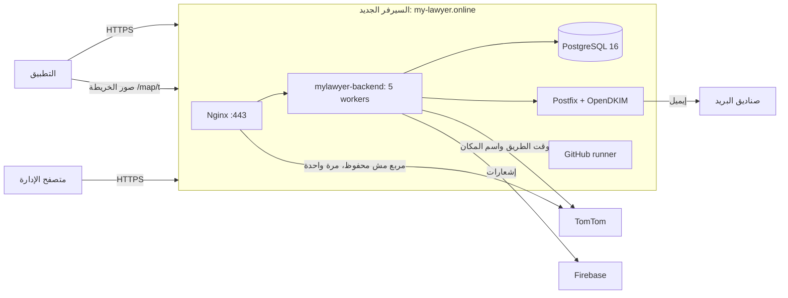

# بنية السيرفرات

**آخر تحقق:** 2026-11-07 (قراءة من السيرفرين). بيانات الدخول وطريقته في `docs/ACCESS.md`، وممنوع أي سر هنا.

## 1. الصورة العامة


## 2. السيرفر الجديد `mylawyer-api` (الباك إند)
| البند | القيمة |
|---|---|
| الموارد | Contabo Cloud VPS 6: 6 معالجات، و12 جيجا رام، و100 جيجا، وSwap 4 جيجا |
| النظام | Ubuntu 24.04، والتوقيت Europe/Berlin |
| الخدمات | `mylawyer-backend` (systemd، `127.0.0.1:4000`، `WEB_WORKERS=5`، حد ذاكرة 8 جيجا)، وPostgreSQL 16 محلي بس، وNginx 1.24، وPostfix (محلي بس، IPv4) وOpenDKIM، وfail2ban، والـ runner |
| الملفات | الكود `/var/www/mylawyer/backend` (و`.env` وملف Firebase جنبه)، والموقع `/var/www/mylawyer/site` (و`current` رابط ليه)، والصور والملفات `/var/www/mylawyer/storage/{public,private_docs}` |
| Nginx | `/etc/nginx/sites-available/mylawyer`، وإعدادات عامة في `/etc/nginx/conf.d/mylawyer-api.conf` و`security_headers.conf`. 20000 اتصال لكل عملية، وTLS 1.2 و1.3 بس |
| PostgreSQL | `/etc/postgresql/16/main/conf.d/90-mylawyer.conf`: ذاكرة 2 جيجا، و120 اتصال، ومهلة 30 ثانية للاستعلام، وتسجيل اللي أبطأ من 500 مللي |
| الجدار الناري | UFW: 22 و80 و443 بس |
| SSH | بالمفتاح بس (`/etc/ssh/sshd_config.d/00-mylawyer.conf`)، وfail2ban بيحظر بعد 5 محاولات |
| DNS السيرفر | `/etc/systemd/resolved.conf.d/mylawyer.conf` (1.1.1.1 و8.8.8.8)، لأن سيرفرات Contabo كانت بتعلّق |
| الشهادة | Let's Encrypt لـ `my-lawyer.online` و`www`، وبتتجدد لوحدها (`certbot.timer`) بالتحقق من `/var/www/letsencrypt` |
| الإيميل | من `noreply@my-lawyer.online`، موقّع DKIM بالمفتاح `mail`، وسجلات SPF وDMARC وMX في Hostinger، والـ PTR في Contabo |

## 3. السيرفر القديم `mylawyer-vps`
مفيش عليه خرايط ولا مواقع. عليه نسخة تانية من النسخ اليومية (`/var/backups/mylawyer-api`) ومراقب بينبّه لو السيرفر الأساسي وقع. الخريطة الحالية في `docs/GPS_SYSTEM.md`.

## 4. الدومين
DNS في Hostinger. `@` و`www` للجديد، و`maps` للقديم. التفاصيل والقيم في `docs/ACCESS.md`.

## 5. أوامر قراءة آمنة
```bash
ssh -F D:/KAREM/.access/ssh_config mylawyer-api 'systemctl is-active mylawyer-backend nginx postgresql postfix; curl -s http://127.0.0.1:4000/api/v1/health'
```
```bash
ssh -F D:/KAREM/.access/ssh_config mylawyer-api 'journalctl -u mylawyer-backend --since "-1h" -p err --no-pager'
```
```bash
ssh -F D:/KAREM/.access/ssh_config mylawyer-vps 'df -h /; ls -la /var/backups/mylawyer-api | tail -3'
```
