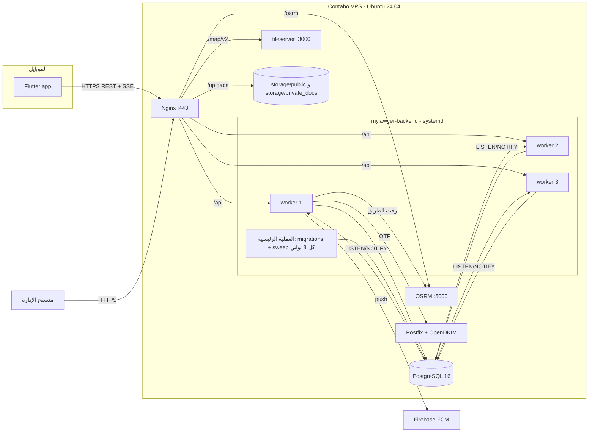
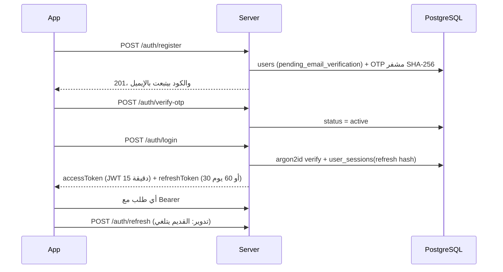
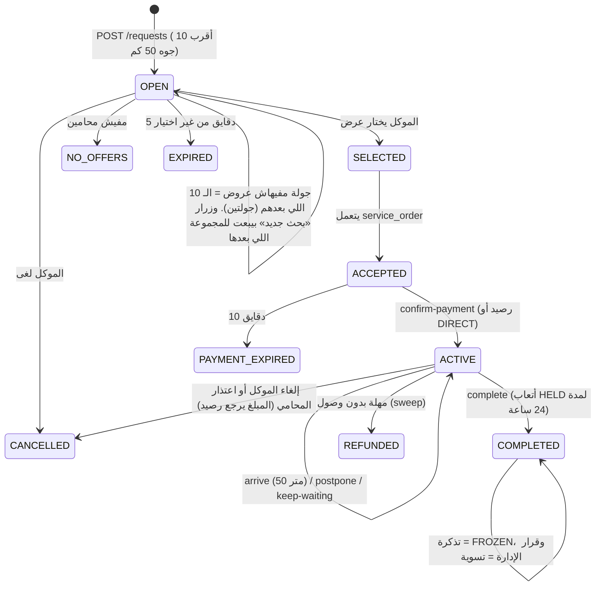

# خريطة النظام

**الغرض:** إيه الموجود فعلًا، وإزاي الأجزاء بتكلم بعض. **آخر تحقق:** 2026-11-06. **الحالة:** VERIFIED من الكود، والسيرفر RUNTIME VERIFIED بالقراءة.

## 1. المكونات

| المكون | المكان | التقنية | نقطة الدخول |
|---|---|---|---|
| تطبيق الموبايل (موكل ومحامي في تطبيق واحد) | `lib/` | Flutter 3.24.3، أندرويد وآيفون | `lib/main.dart` ثم `features/auth/session_router.dart` |
| الخادم | `backend/src` | Node 20، Fastify 5، TypeScript، `pg` | `backend/src/server.ts` |
| لوحة التحكم | `backend/public/admin` | JS عادي من غير مكتبات، والخادم بيقدمها | `GET /api/v1/admin-panel` (`modules/admin/panel.ts`) |
| الموقع العام والسياسات | `backend/public/site` | HTML ثابت | Nginx على `/` |
| قاعدة البيانات | `backend/migrations` (30 ملف) | PostgreSQL 16 | `src/database/migrate.ts` بيشتغل مع كل تشغيل |
| الخرائط والطرق | `backend/map-services` | Docker: tileserver وOSRM | Nginx على `/map/v2` و`/osrm/` |
| الرفع التلقائي | `.github/workflows/deploy.yml` و`backend/deploy.sh` | GitHub Actions، والـ runner على السيرفر | push على `main` يغيّر `backend/**` |
| الاختبارات | `test/` (Flutter) و`backend/tests` | `flutter test`، و`node --test` مع PGlite | - |

خدمات خارجية: Firebase Cloud Messaging للإشعارات (`services/pushService.ts`)، وPostfix محلي للإيميل (`services/emailService.ts`). مفيش بوابة دفع (NOT IMPLEMENTED).

## 2. الصورة العامة

## 3. مسار الطلب الواحد جوه الخادم

`Nginx` ← `app.ts` (helmet، cors، rate-limit بالحساب أو العنوان، multipart، jwt) ← `requireAuth` في `onRequest` ← فحص الإيقاف في `preHandler` (استعلام على `users` مع كل طلب فيه تسجيل دخول) ← الـ handler في `modules/<الوحدة>` ← `query` أو `withTransaction` من `database/index.ts` ← الرد `{ success, data | error }`. أي `HttpError` بيرجع رسالة عربية، وأي خطأ 500 بيتسجل ويرجع رسالة عامة (`app.ts` السطر 34).

ما فيش طبقة service أو repository منفصلة في أغلب الوحدات: الـ SQL مكتوب جوه الـ routes، والمنطق المشترك في `modules/lifecycle` و`modules/requests/service.ts` و`modules/support/service.ts`.

## 4. الدخول والجلسات

- الأدوار: `client` و`lawyer` و`admin`، ومكتوبة جوه الـ JWT. تغيير الدور بيتأخر لحد 15 دقيقة، لكن الإيقاف بيتطبق فورًا من الـ `preHandler`.
- التطبيق بيحفظ الجلسة في `SharedPreferences` (مش مشفرة)، وده متسجل في `TASKS.md`.
- اللوحة بتحفظ الجلسة في `sessionStorage`، وبيحميها CSP صارم (`panel.ts`)، ومفيش `innerHTML` في كود اللوحة.

## 5. رحلة «محاميك حالاً» (الحالية)

المسار القديم (`POST /orders` لمحامي واحد مع سعر عشوائي من `client_problem_prices`) لسه شغال للنسخ القديمة من التطبيق، والتطبيق الحالي ما بيستخدموش. الحالة **DEPRECATED**.

## 6. الفلوس (دفتر حسابات من غير أرصدة مخزنة)

- **رصيد الموكل** = `SUM(client_credits.amount)`.
- **رصيد المحامي المتاح** = `SUM(service_orders.payout_amount WHERE payout_status = 'AVAILABLE')` + `SUM(lawyer_adjustments.amount)` (`wallet/routes.ts` `spendableBalance`).
- **حالات الأتعاب:** `HELD` بعد الإنهاء، وبعد 24 ساعة `AVAILABLE`، و`FROZEN` بالتذكرة أو الإدارة، و`REFUNDED`.
- **العمولة والضريبة** بيتقفلوا على الطلب ساعة إنشائه، وصافي المحامي في `lawyerShare()` (`lifecycle/service.ts`).
- **الأقفال:** كل خطوة فيها فلوس بتقفل الحساب (`SELECT ... FROM users FOR NO KEY UPDATE`) والطلب (`lockOrder`، `FOR UPDATE`).
- **مفيش سحب لفلوس حقيقية** (NOT IMPLEMENTED)، ومفيش تحصيل حقيقي.

## 7. التحديث الحي

- `GET /api/v1/events` خط SSE لكل جهاز، بحد 3 خطوط للشخص، ونبضة كل شوية (`services/liveUpdates.ts`).
- أي تغيير بيتكتب في `change_log` وبيتبعت بـ `pg_notify` جوه نفس المعاملة، فمش بيوصل غير بعد الحفظ. وكل worker بيسمع بـ `LISTEN`.
- الجهاز اللي الخط بتاعه قطع بيطلب `GET /events/since?after=N`، ولو فاته أكتر من 200 تغيير أو الأرشيف اتمسح (بعد يومين) بيحمّل كل حاجة من الأول.
- **الإشعارات المهمة** بتروح كمان لـ FCM، والهادية (قايمة `QUIET_TITLES`) بتفضل جوه التطبيق بس.

## 8. المهام الزمنية

`sweepLifecycle()` (`lifecycle/sweep.ts`) بيشتغل في العملية الرئيسية بس كل 3 ثواني، والجولة الجاية ما بتبدأش قبل ما اللي قبلها تخلص. فيه 12 خطوة: إقفال الطلبات اللي ما اتردش عليها، وتقديم جولات العروض، وإقفال اللي ما اتدفعش، وفك الإيقاف، وإخفاء المحامي الساكت 10 دقايق، وتنظيف الإشعارات (30 يوم) و`change_log` (يومين)، والتذكيرات، ورد الفلوس عند عدم الوصول، وتحرير الأتعاب المحجوزة، وتذكير التقييم.

## 9. السيرفر (قراءة 2026-11-06)

| البند | الوضع |
|---|---|
| المنافذ المفتوحة للخارج | 22 و80 و443 (UFW). الخادم على `127.0.0.1:4000`، وPostgreSQL وOSRM وtileserver محليين بس |
| العمليات | `WEB_WORKERS=3`، و`DB_POOL_MAX=15` لكل worker (يعني 60 اتصال كحد أقصى من 120 مسموحين) |
| الذاكرة والقرص | 7.8 جيجا رام منها 3.3 مستخدمة، وSwap 4 جيجا، والقرص 25% |
| Nginx | gzip شغال، وHSTS شغال، وحدود طلبات للدخول والخرائط والطرق |
| النسخ الاحتياطية | `deploy.sh` بيعمل نسخة مع كل رفع، على نفس السيرفر بس. مفيش نسخة يومية ولا نسخة بره السيرفر |
| SSH | بالمفتاح بس |
